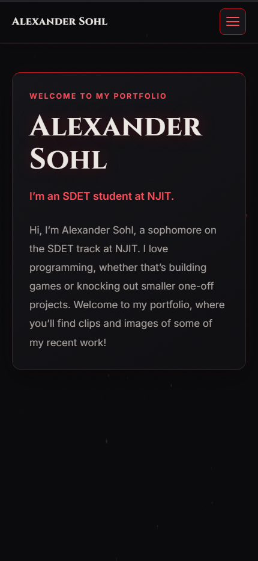
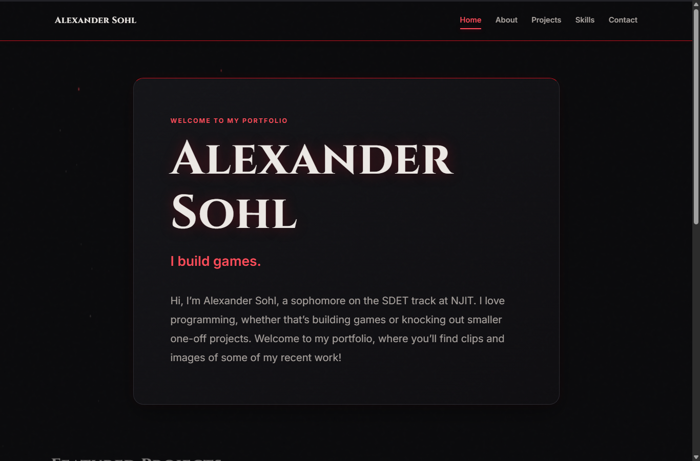

# Portfolio Website Project Report

**Live site:** https://alexandersohl.github.io/portfolio/  
**GitHub repository:** https://github.com/AlexanderSohl/portfolio

## Overview

This is my five-page personal portfolio. I'm an SDET student at NJIT, and the site presents my background, skills, projects, and contact details in a responsive Crimson Gothic design. I built it with plain HTML, CSS, and JavaScript, using Codex one task at a time, and deployed it with GitHub Pages.

## Features

- Home page with an animated typewriter introduction, featured project previews, skill tags, and a contact button.
- About and Projects pages told as scroll-based chapter stories. Project visuals update with the active step, and the rover illustration draws its route as you scroll.
- Three project videos with native controls, plus full-screen project images that open and close with the keyboard.
- A Skills page grouped by area with proficiency badges.
- A contact form with field-by-field validation that prepares an email to my address.
- A responsive hamburger menu, a scroll progress bar, an ember background, and Goob, the mascot from my game. All animation turns off when a visitor has reduced motion enabled.

## Challenges and Solutions

**Pinned project visuals.** Keeping the project images readable while they stay pinned during scrolling was the hardest part. The images kept overlapping the chapter headings. I solved it by updating each image's position relative to its chapter heading as the page scrolls. I also made the About page's progress line calculate its length from the number of chapter steps, so it still reaches the end when I add sections.

**One stylesheet rule.** The assignment allows one external stylesheet, but loading Google Fonts with a `<link>` tag counted as a second one. My stylesheet test (T07) failed because of it. I moved the Cinzel and Inter font declarations into `css/style.css` with `@font-face`, which left each page with a single stylesheet link, and the re-run passed.

## A Codex Mistake and How I Fixed It

When I asked Codex to keep project headings above the pinned images, its first fix only added a stacking layer (z-index). The headings drew on top, but when I scrolled back up, the images still slid up over them. I caught this while testing, and I had Codex adjust the pinned image's position as the chapter heading moved, which fixed it. Commits `f919d81` and `8c1026f` show the first attempt and the correction.

## Screenshots

Phone view (430 × 932):

Laptop view (1366 × 900):

## Testing and Accessibility

My test plan is in [TESTING.md](TESTING.md). It has 21 test cases, all run on the live GitHub Pages site. They cover every navigation link, phone and laptop layouts, keyboard navigation with Tab and Enter, every JavaScript feature (including valid and invalid contact form input), reduced motion, and console errors. Lighthouse Accessibility scored 100 on all five pages.
